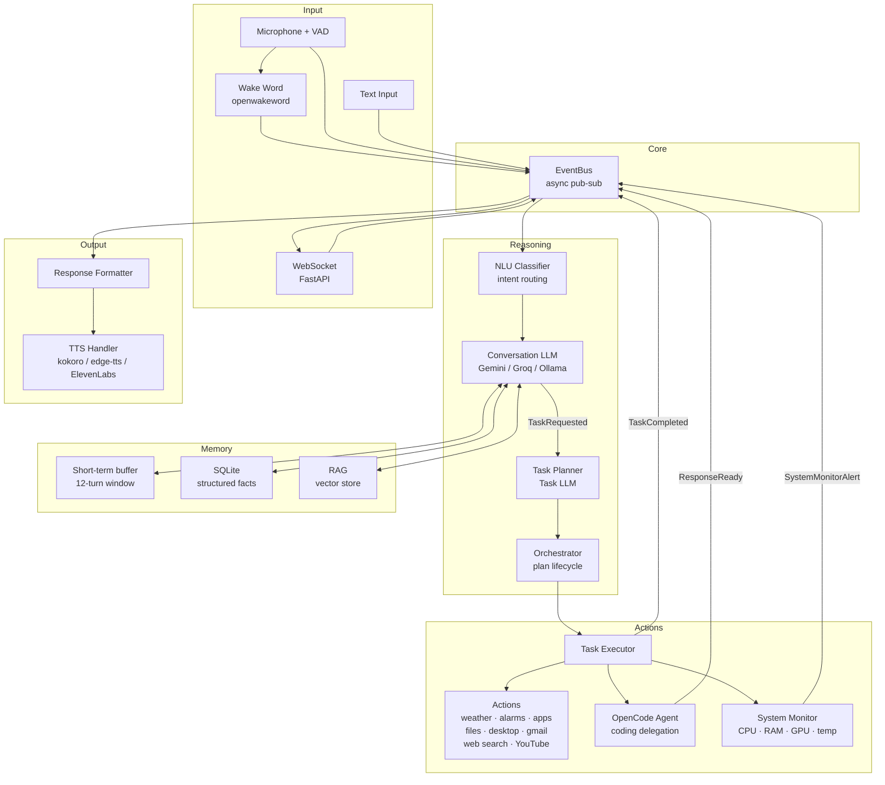

# Kancha (JARVIS)

An event-driven, async voice AI assistant with multi-provider LLM routing, hybrid memory, multi-step task planning, and an optional coding agent.

---

## Overview

Kancha is the engine behind a personal AI assistant called JARVIS. It is built around an async **EventBus** where every capability (voice input, reasoning, memory, task execution, TTS) is a decoupled subscriber. A user utterance — spoken or typed — travels through the bus as a chain of typed events and produces a spoken or printed response.

It solves the problem of wiring many noisy subsystems (microphone, LLM APIs, databases, desktop automation, email) into a single coherent loop without tight coupling. Because everything is event-driven, any module can be swapped, disabled, or extended without touching the others.

---

## Features

**Implemented**

- **Dual input modes** — `--text` (keyboard) and `--voice` (microphone with Silero VAD + Groq Whisper STT)
- **Wake-word gating** — openwakeword "hey_jarvis" model; gated session with idle timeout
- **Multi-provider LLM routing** — Gemini (default, multi-key rotation), Groq, Ollama; hot-swappable at runtime via a settings file
- **Dual LLM lanes** — separate Conversation LLM and Task LLM running on independent key pools
- **NLU classifier** — LLM-based intent routing into `CONVERSATIONAL`, `QUERY`, or `TASK`
- **Multi-step task planner** — decomposes requests into `ExecutionPlan` steps, re-plans on failure
- **Task executor** — dispatches to actions: `open_app`, alarms, weather, file operations, desktop control, web search, YouTube, Gmail, system monitor
- **Hybrid memory** — in-memory conversation buffer + SQLite structured facts + pluggable RAG (sqlite/numpy default, optional chromadb)
- **RAG pipeline** — ingests PDFs, DOCX, and text files; Gemini or Ollama embeddings; prefetch on every utterance
- **TTS** — kokoro-onnx (local/offline), edge-tts, ElevenLabs, and sounddevice playback; mutex-serialised
- **Acoustic echo cancellation** — prevents the microphone from picking up TTS output
- **OpenCode agent delegation** — delegates coding tasks to a managed OpenCode server subprocess; streams progress as voice updates
- **System monitoring** — background CPU/RAM/GPU/temperature loop with configurable alert thresholds
- **FastAPI + WebSocket server** — REST and real-time WebSocket API for a web frontend
- **Desktop automation** — window management, workspace switching, wallpaper, file organisation (Linux)
- **Gmail integration** — read and send email via IMAP/SMTP
- **Token logging** — per-session JSONL token usage log

**Planned / Experimental**

- ChromaDB as an alternative RAG vector store (dependency is commented out; set `KANCHA_RAG_VECTOR_STORE=chroma` once installed)
- Ollama embeddings provider (no extra package needed beyond httpx)
- Scripted demonstration mode (`--script FILE`)

---

## Architecture



---

## Tech Stack

| Technology                     | Purpose                                     |
| ------------------------------ | ------------------------------------------- |
| Python 3.12+ / asyncio         | Async runtime                               |
| Google Gemini (`google-genai`) | Primary conversational and task LLM         |
| Groq API                       | STT (Whisper) + optional LLM provider       |
| Ollama                         | Local LLM option (no key required)          |
| FastAPI + Uvicorn              | REST + WebSocket API server                 |
| aiosqlite                      | Async SQLite (structured memory, RAG store) |
| openwakeword                   | Wake-word detection ("hey jarvis")          |
| Silero VAD (ONNX)              | Voice activity detection                    |
| kokoro-onnx                    | Offline neural TTS                          |
| ElevenLabs                     | Cloud TTS alternative                       |
| sounddevice + PyAudio          | Audio I/O                                   |
| numpy                          | Embedding arithmetic and audio processing   |
| psutil + pynvml                | System metric collection                    |
| pyautogui                      | Desktop GUI automation                      |
| Playwright                     | Browser automation (web search)             |
| yt-dlp                         | YouTube video lookup and playback           |
| Pydantic v2                    | Schema validation throughout                |
| python-dotenv                  | Environment configuration                   |

---

## Project Structure

```
kancha/
├── main.py                  # CLI entry point (--text / --voice)
├── core/
│   ├── bus.py               # Async EventBus (publish-subscribe)
│   ├── events.py            # All typed event dataclasses (~30 events)
│   ├── pipeline.py          # Wires every module onto a shared bus
│   └── system_monitor_loop.py
├── reasoning/
│   ├── coordinator.py       # Conversation LLM controller
│   ├── llm_client.py        # Gemini client with multi-key rotation
│   └── providers/           # Gemini, OpenAI-compat, registry + hot-swap
├── planning/
│   ├── planner.py           # Task LLM — decomposes multi-step requests
│   ├── orchestrator.py      # Manages plan lifecycle and re-planning
│   └── scheduler.py         # Executes individual plan steps
├── memory/
│   ├── manager.py           # Short-term buffer + structured SQLite facts
│   ├── structured.py        # SQLite-backed fact store
│   ├── rag/                 # RAG pipeline (chunking, embeddings, store, router)
│   └── activity_memory.py   # Project-scoped activity log
├── nlu/
│   └── classifier.py        # LLM-based intent classification
├── tasks/
│   ├── executor.py          # Routes TaskExecutionRequested → action handlers
│   ├── registry.py          # Task metadata and validation
│   └── scheduler.py         # Alarm scheduling
├── actions/
│   ├── weather.py           # wttr.in weather integration
│   ├── alarms.py            # Alarm set / list / cancel
│   ├── apps.py              # Application launcher
│   ├── file_controller.py   # File CRUD operations
│   ├── desktop_control.py   # Linux window / workspace / wallpaper control
│   ├── gmail_client.py      # Gmail IMAP/SMTP client
│   ├── web_search.py        # Web search via Playwright
│   ├── youtube_video.py     # YouTube via yt-dlp
│   └── system_monitor.py    # CPU / RAM / GPU / temperature metrics
├── agent/
│   ├── client.py            # OpenCode HTTP client (spawns server subprocess)
│   └── config.py            # OpenCode configuration
├── input/
│   ├── stt.py               # Microphone → Silero VAD → Groq Whisper
│   ├── wake_word.py         # openwakeword detector
│   └── gated_session.py     # Wake-word gated voice session
├── output/
│   ├── tts.py               # TTS handler (kokoro-onnx / edge-tts / ElevenLabs)
│   └── response_formatter.py
└── api/
    ├── server.py            # FastAPI app + WebSocket endpoint
    └── routes/              # REST routes: health, memory, history, rag, tasks, …
```

---

## Installation

Requires **Python 3.12+** and [`uv`](https://github.com/astral-sh/uv).

```bash
git clone [<repo-url>](https://github.com/Sangam-dev/MARK-I.git)
cd kancha
uv sync
```

Copy the example environment file and fill in your keys:

```bash
cp .env.example .env
```

---

## Usage

**Text mode** (no microphone or Groq key required):

```bash
uv run main.py --text
```

**Voice mode** (requires `GROQ_API_KEY`):

```bash
uv run main.py --voice
```

**API server** (FastAPI + WebSocket, for the web frontend):

```bash
uv run -m uvicorn api.server:app --reload
```

**Common flags:**

```
--no-tts            Print responses only, no audio
--session ID        Isolate memory by session name
--log-level DEBUG   Verbose logging
--max-prompt-tokens N  Cap LLM context size (default: 4000)
```

---

## Configuration

All configuration is via environment variables in `.env`. Required keys are marked with `*`.

| Variable                    | Default              | Description                                      |
| --------------------------- | -------------------- | ------------------------------------------------ |
| `GEMINI_API_KEY` *          | —                    | Primary LLM (Gemini)                             |
| `GROQ_API_KEY`              | —                    | Voice STT + optional LLM; required for `--voice` |
| `KANCHA_LLM_PROVIDER`       | `gemini`             | Active LLM provider (`gemini`, `groq`, `ollama`) |
| `KANCHA_RAG_ENABLED`        | `0`                  | Enable RAG semantic memory                       |
| `KANCHA_TTS_ENABLED`        | `true`               | Enable text-to-speech                            |
| `KANCHA_VOICE_ENABLED`      | `true`               | Enable microphone input in API server            |
| `KANCHA_MONITOR_INTERVAL`   | `30`                 | System monitor polling interval (seconds)        |
| `KANCHA_OPENCODE_ENABLED`   | `1`                  | Enable OpenCode coding agent delegation          |
| `KANCHA_OPENCODE_WORKSPACE` | `~/kancha-workspace` | Where delegated coding tasks run                 |
| `GMAIL_ADDRESS`             | —                    | Gmail account for email actions                  |
| `GMAIL_APP_PASSWORD`        | —                    | Gmail App Password (not your account password)   |

Multiple Gemini keys are supported via `GEMINI_API_KEY_1`, `GEMINI_API_KEY_2`, … for automatic rotation between them.

---

## Roadmap

- ChromaDB as an alternative RAG vector store backend
- Ollama-based local embeddings
- Scripted scenario playback (`--script`)
- Expanded web frontend (`jarvis_frontend`)
